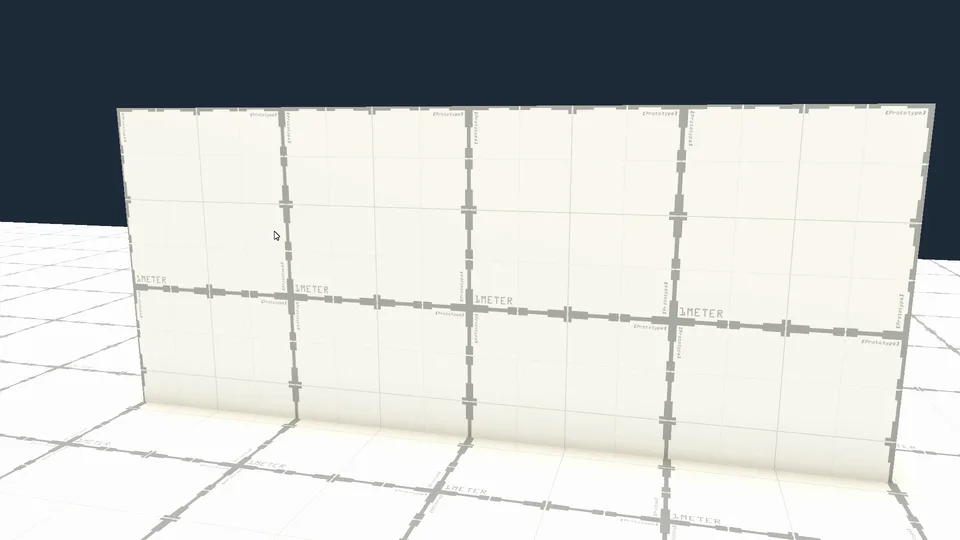
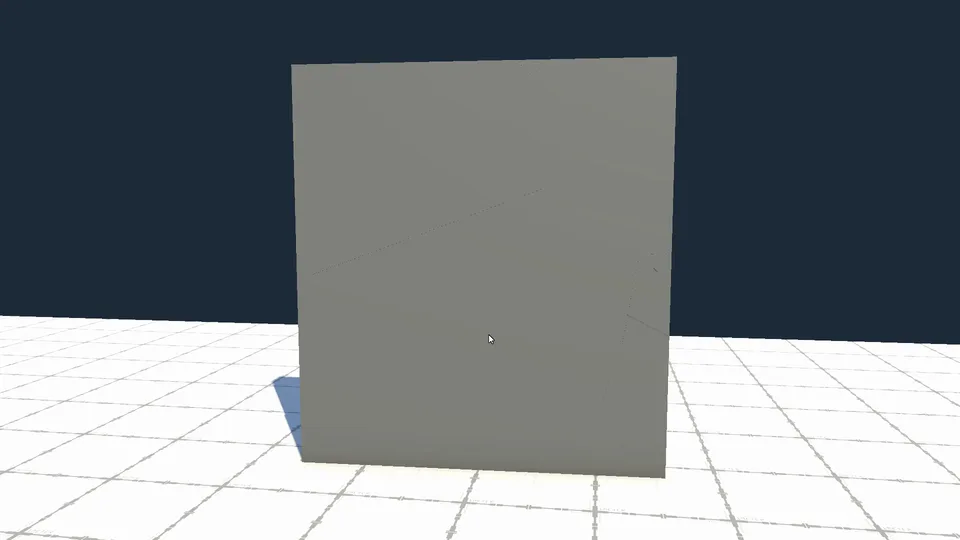

# No Bug Deal · Destrucción de paredes

Una escena para perforar una pared en tiempo real y otra para derribar las piezas de una pared prefabricada. [Descargar para Windows](https://github.com/shaw207/nobugdeal-destruction/releases/tag/v1.0.0)

<strong>F1 · Pared perforable</strong>

Tres cortes circulares se unen. Al perder el último apoyo, una sección cae con su abertura intacta.

Clic izquierdo para un círculo, derecho para un cuadrado y central para un corte alargado.

<strong>F2 · Pared prefabricada</strong>

La pared tiene 18 piezas. El clic izquierdo suelta la pieza tocada y puede desprender otras a un metro o menos del impacto. El derecho amplía el radio a 5,4 m. Cada impacto suelta hasta seis piezas.

Descomprime el ZIP y abre `Fest-MeshDestruction.exe`. **F1 / F2** cambian de pared, **R** la restaura y **Esc** cierra la demo. En Unity **6000.3.5f2**, abre una de las [escenas de prueba](Assets/Demo) y pulsa **Play**.

**Chengxun Wu (shaw207)** programó los sistemas de destrucción. Los modelos y materiales de *No Bug Deal* se usan con permiso del equipo. [Créditos](CREDITOS.txt)
